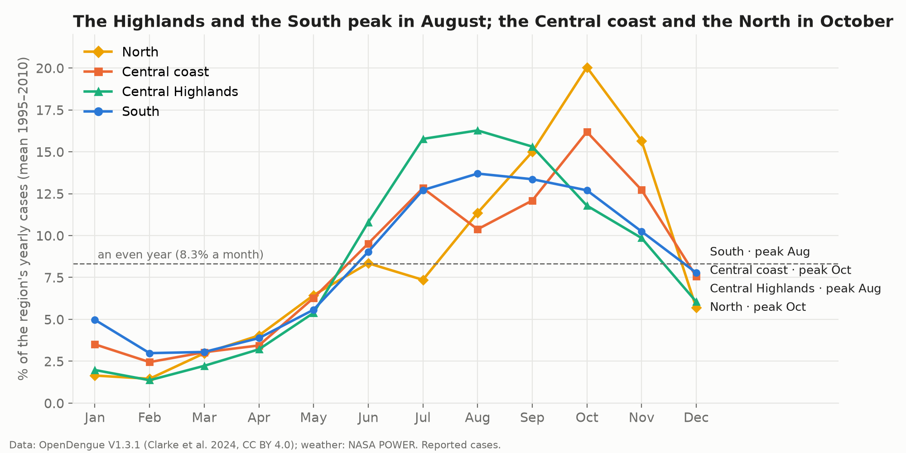

# Dengue in Vietnam: when and where does the season hit, and does rain warn us early?

Google Data Analytics Capstone, Track B: own topic, own data, ~30-minute presentation. Analysis in **Python (pandas, DuckDB)** on **12,273 province-months** of reported dengue cases (64 provinces, 1994–2010), a national series to 2024, provincial population from the General Statistics Office and NASA POWER weather for 11 provinces.



## Business task
A pest-control services company (the same plan works for a provincial Center for Disease Control) schedules vector-control staff, insecticide stock and community campaigns for the dengue season. **When in the year and where do reported dengue cases rise, and how strongly do they follow rainfall and temperature in the preceding months,** so the client can prepare one to two months before each regional peak? Details and the five guiding questions: [docs/topic_selection.md](docs/topic_selection.md).

**Stakeholders:** operations director, regional managers (North, Central coast, Central Highlands, South), finance, public-health partners.

## Elevator pitch
> I analysed 17 years of monthly dengue cases for all 64 provinces of Vietnam, plus national figures up to 2024 and NASA weather data, to help a pest-control company plan its season. Dengue is a predictable June-to-November season, with almost three quarters of cases, but the regions are staggered: the South and the Central Highlands peak in August, the Central coast and the North in October. The South carries two thirds of the cases, and per person the Mekong Delta runs at more than twice the national rate, while Ho Chi Minh City leads in cases only because it is large. Rain runs about a month ahead of cases in the Mekong Delta, but a wetter-than-usual month does not predict a worse season, so the client should plan by calendar and region and keep surge capacity for outbreak years. I did the work in Python with pandas and DuckDB.

## Key findings
| # | Finding | Evidence |
| ---: | --- | --- |
| 1 | The typical year has **doubled**; outbreak years are **4–5×** a typical year | median year 51,004 (1980–1999) → 62,936 (2000–2009) → 109,041 (2010–2024); outbreaks above mean + 2 SD: 1987 (354,517), 2019 (320,702), 2022 (367,729) |
| 2 | The season is **regular** | June–November holds 72.9% of a year's cases (February–April 9.5%); peak in July–October in 15 of 16 years |
| 3 | The **South carries the load** | South 68.3% of cases, Central coast 23.7%, Central Highlands 4.3%, North 3.7%; 10 provinces (9 in the South) = 53.6%; Ho Chi Minh City 7,105 cases a year |
| 4 | **Per person, the Mekong Delta carries the highest risk** | 2004–2010: Vietnam 108.5 cases per 100,000 a year, Mekong Delta 276.8 (2.6×); Ca Mau, Tien Giang, Soc Trang, Dong Thap 375–395; Ho Chi Minh City #1 by cases but #17 per person (157.8) |
| 5 | **Timing differs by region** | Highlands and South peak in August; Central coast in October after a July hump; the North climbs from August and has 50.7% of its cases in September–November |
| 6 | The **North is small but volatile** | Ha Noi: about 100 cases a year around 2000, 16,175 in 2009 (North = 16.7% of national cases that year) |
| 7 | **Weather runs ahead of the season** | rain leads cases by ~1 month in the Mekong Delta (An Giang ρ 0.58, Tien Giang 0.52); temperature leads by 2–3 months in the North and Centre (Ha Noi 0.52, Da Nang 0.62) |
| 8 | **Unusual rain does not predict an unusual season** | rain anomaly vs case anomaly: median ρ 0.00–0.05; temperature anomaly: weak, median 0.10–0.18 (Da Nang 0.33, Khanh Hoa 0.27) |
| 9 | **Recent seasons run later** | 2024: June 4.8% of cases (usual 9.2%), December 11.7% (usual 7.5%), peak in October |

Charts: [`figures/`](figures/) · full analysis: [`notebooks/analysis.ipynb`](notebooks/analysis.ipynb) · slides: [`slides/dengue_case_study.pptx`](slides/dengue_case_study.pptx) · interactive dashboard: [Tableau Public](https://public.tableau.com/app/profile/ha.nguyen.thi.thu8875/viz/DengueinVietnamseasonprovincesandincidence_/Dashboard1)

## Top high-level insights
1. Dengue is a **predictable June–November season** (73% of cases): the calendar alone tells the client when to prepare.
2. **Where matters more than when:** the South carries 68% of cases; per person the Mekong Delta runs at 2.6× the national rate, while Ho Chi Minh City leads in cases only because it is large.
3. **Regions are staggered:** one national schedule would be early for the North and late for the South.
4. **Weather confirms timing but does not forecast severity:** bad years (4–5× normal) need surge capacity, not a rain forecast.
5. **The baseline is rising and recent seasons run later:** the typical year doubled since the 1990s, and in 2024 cases stayed high into December.

## Recommendations
1. **Regional preparation calendar.** Stock and staff in place by **May** in the South, the Central Highlands and the Central coast; by **July** in the North; keep crews on until **December**.
2. **Allocate by burden, two ways.** Size crews by case counts (about two thirds of capacity to the South, a quarter to the Central coast) and set the intensity of household-level larval control by incidence, highest in Ca Mau, Tien Giang, Soc Trang, Dong Thap, Ben Tre and Khanh Hoa; keep a flexible reserve for the North, whose rare outbreaks are large.
3. **Weather as a timing trigger, not a severity forecast.** Start larval-control campaigns in the South when the rainy season sets in (May–June); plan a surge contract for outbreak years instead of scaling with rainfall.

## Additional deliverables for further exploration
- Province data after 2010 (Ministry of Health / Pasteur Institutes), mapped to the 34 provinces created in 2025, to update incidence.
- District-level cases inside Ho Chi Minh City and the Mekong Delta, to find hotspots within large provinces.
- An early-warning model combining lagged cases, temperature anomalies and El Niño indices, tested on held-out years.
- Entomological indices (Breteau, House index) and district-level cases from the client.
- A monthly Tableau dashboard refreshed with new national figures.

## Limitations
- Province data ends in 2010; 2024 is a single recent national check.
- Reported cases understate infections; reporting practice changes over time.
- One weather point (the provincial capital) per province, for 11 provinces.
- Correlation is not causation: urbanisation, water storage, immunity, serotypes and control campaigns also matter.
- Incidence covers 2004–2010 only, the years in which cases and population share the same province boundaries.

## Process
| Phase | Where |
| --- | --- |
| Ask | [docs/topic_selection.md](docs/topic_selection.md), notebook §1 |
| Prepare | [docs/data_sources.md](docs/data_sources.md), `scripts/download_data.py`, notebook §2 |
| Process | notebook §3, [docs/changelog.md](docs/changelog.md), `scripts/regions.py` |
| Analyze | notebook §4 |
| Share | notebook §5, `figures/`, `slides/`, `data/clean/tableau_*.csv` |
| Act | notebook §6, this README |

## Run it
```bash
python3 -m venv .venv && source .venv/bin/activate
pip install -r requirements.txt
python scripts/download_data.py      # OpenDengue (~55 MB zip), NASA POWER, population, boundaries; not committed
jupyter lab notebooks/analysis.ipynb
python slides/build_slides.py        # rebuild the deck from figures/
```

Data: OpenDengue, Clarke et al. (2024), *Scientific Data* 11, 296, https://doi.org/10.1038/s41597-024-03120-7 (CC BY 4.0). Population: General Statistics Office of Vietnam, table V02.03-07. Boundaries: geoBoundaries VNM ADM1 (public domain). Weather: these data were obtained from the NASA Langley Research Center (LaRC) POWER Project funded through the NASA Earth Science/Applied Science Program.
